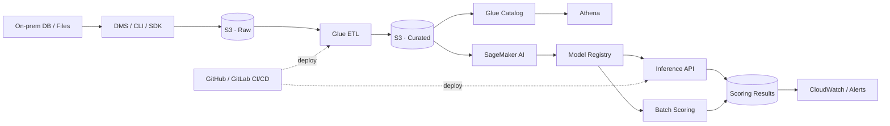

# AWS Use Case Learning Map

HANDS-ON CLOUD LEARNING · 2026

# Learn AWS by building real systems.

Từ nền tảng dữ liệu đến Machine Learning, CI/CD và vận hành production. Học từng dịch vụ qua use case thực tế, kiến trúc trực quan và lab có thể chạy lại.

[🚀 Bắt đầu lộ trình](roadmap/index.md){ .md-button .md-button--primary }
[📋 Xem kế hoạch dự án](project/todos.md){ .md-button }

  12 USE CASES5 LEARNING DOMAINSHANDS-ON FIRST

## Chọn hành trình của bạn

A / 01–03
<h3>Data Platform</h3>

Đưa dữ liệu lên AWS, xây Data Lake, ETL và migration database.

<strong>3 use cases</strong> 
[Khám phá Data Platform →](usecases/data-platform/uc01-upload-data.md)

B / 04–06
<h3>Machine Learning</h3>

Training, quản lý phiên bản, deploy API, batch scoring và monitoring.

<strong>3 use cases</strong> 
[Khám phá Machine Learning →](usecases/machine-learning/uc04-model-training.md)

C / 07–09
<h3>DevOps</h3>

Kết nối GitHub/GitLab, tự động build, test và deploy.

<strong>3 use cases</strong> 
[Khám phá DevOps →](usecases/devops/uc07-github-aws.md)

D / 10–11
<h3>Operations</h3>

Lập lịch pipeline, giám sát hệ thống, cảnh báo và xử lý incident.

<strong>2 use cases</strong> 
[Khám phá Operations →](usecases/operations/uc10-scheduling.md)

E / 12
<h3>Security & Governance</h3>

IAM, encryption, backup, disaster recovery và quản trị.

<strong>1 use case</strong> 
[Khám phá Security →](usecases/security/uc12-security-backup-dr.md)

## Learning path

01
<h3>Foundation & Data</h3>

UC01 → UC02 → UC03

02
<h3>Machine Learning</h3>

UC04 → UC05 → UC06

03
<h3>DevOps & Automation</h3>

UC07 → UC08 → UC09 → UC10

04
<h3>Production Ready</h3>

UC11 → UC12

## Reference architecture — Retail Credit Risk Platform

Dùng dữ liệu **synthetic** để thực hành trọn luồng Data Engineering → ML → Operations. Không sử dụng dữ liệu khách hàng hoặc cấu hình nội bộ.

## Cách học một use case

1. **Understand** — đọc business scenario, mục tiêu và prerequisites.
2. **Design** — xem architecture, data flow và lựa chọn dịch vụ.
3. **Compare** — phân tích dịch vụ thay thế và trade-offs.
4. **Build** — làm lab theo từng bước bằng Console, CLI, SDK và Terraform.
5. **Validate** — kiểm tra output, test, logs và failure scenarios.
6. **Operate & clean up** — theo dõi chi phí, vận hành và xóa tài nguyên.

## Nguyên tắc nội dung

- Tiếng Việt, giữ nguyên thuật ngữ kỹ thuật tiếng Anh.
- Mỗi AWS service có 10 câu hỏi WH và so sánh lựa chọn thay thế.
- Sơ đồ có mã nguồn Mermaid/Draw.io; hình có chú thích và nguồn.
- Lab ưu tiên synthetic data, least privilege, repeatability và cleanup.
- Chi phí là phần bắt buộc, không mặc định tài nguyên AWS là miễn phí.

> **Trạng thái hiện tại:** Portal foundation và implementation backlog đang được khởi tạo. Các use case sẽ được đánh dấu hoàn thành sau khi nội dung và lab được kiểm chứng.
