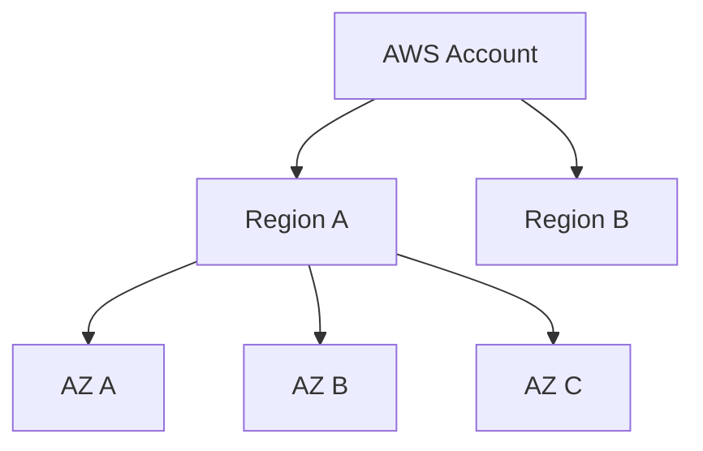

# AWS Fundamentals

Trang này là checklist nền tảng trước khi triển khai các use case. Thực hiện trên AWS learning account riêng.

## Account, Region và Availability Zone

- **AWS account:** ranh giới quản trị, billing và quota.
- **Region:** khu vực địa lý chứa các AWS resources.
- **Availability Zone (AZ):** vị trí hạ tầng độc lập trong một Region.
- Chọn Region dựa trên latency, data residency, service availability và chi phí; không mặc định mọi dịch vụ có mặt ở mọi Region.



## IAM và nguyên tắc least privilege

- Ưu tiên IAM Identity Center/federation và temporary credentials.
- Dùng IAM role cho workload và GitHub Actions OIDC.
- Tránh root user cho công việc hàng ngày; bật MFA.
- Không cấp `AdministratorAccess` cho lab nếu quyền hẹp hơn là đủ.
- Review trust policy, permissions policy và resource policy.

## AWS CLI

Cài AWS CLI v2 từ [hướng dẫn chính thức](https://docs.aws.amazon.com/cli/latest/userguide/getting-started-install.html).

Kiểm tra phiên bản:

```bash
aws --version
aws sts get-caller-identity
```

Không paste access key vào terminal history, notebook hoặc repository.

## Cost management trước khi làm lab

- Thiết lập AWS Budgets và billing alarms.
- Chọn Region và instance/storage tier phù hợp.
- Ghi rõ runtime dự kiến; tắt/xóa endpoint, database, NAT Gateway và tài nguyên tính phí theo giờ khi không sử dụng.
- Kiểm tra chi phí thực tế trong Billing/Cost Explorer; free tier không đồng nghĩa mọi thành phần đều miễn phí.

## 10 WH — khung câu hỏi học AWS

Áp dụng bộ câu hỏi này khi tìm hiểu từng AWS service hoặc concept. Không đưa bộ câu hỏi này vào các trang use case.

| Câu hỏi | Nội dung cần tìm hiểu |
|---|---|
| What | Dịch vụ/khái niệm là gì? Capability và giới hạn cốt lõi? |
| Why | Giải quyết vấn đề nào? Giá trị và lý do sử dụng? |
| When | Khi nào nên dùng và trường hợp nào không phù hợp? |
| Where | Hoạt động ở phạm vi Region/AZ/account/network nào? |
| Who | Ai sử dụng, vận hành và principal nào cần quyền? |
| Which | Nên chọn service, mode, tier hoặc configuration nào? |
| How | Cách hoạt động, triển khai và tích hợp ra sao? |
| How much | Pricing dimensions, cost drivers và cách ước tính? |
| What if | Failure modes, limits, security risks và recovery? |
| How compared | Khác gì với alternatives; trade-offs và tiêu chí lựa chọn? |

## Checklist

- [ ] MFA đã bật cho identity quản trị.
- [ ] Có learning role riêng với quyền tối thiểu.
- [ ] Đã chọn Region và xác nhận service availability.
- [ ] Đã thiết lập budget/billing alert.
- [ ] Đã kiểm tra AWS CLI identity.
- [ ] Hiểu cleanup và trách nhiệm chi phí.
