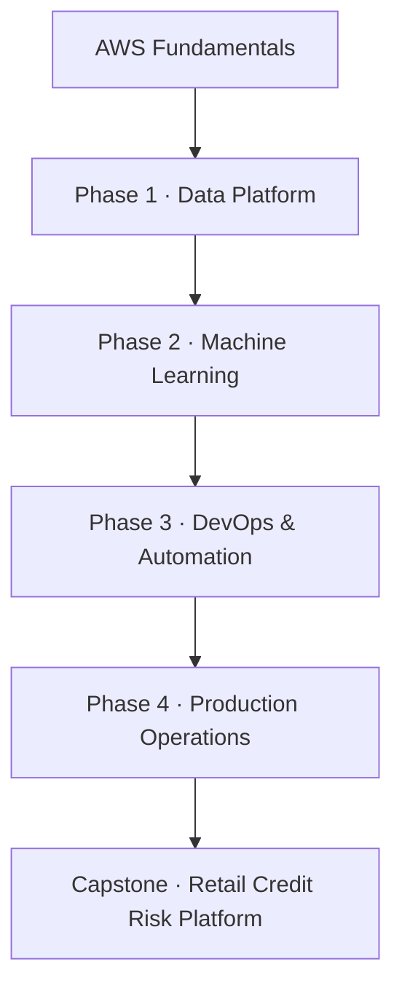

# AWS Learning Roadmap

## Lộ trình tổng thể

| Phase | Use cases | Kết quả mong đợi |
|---|---|---|
| 0. Foundation | AWS Fundamentals | Hiểu account, IAM, Region, CLI, budgets |
| 1. Data Platform | UC01–UC03 | Ingestion, lakehouse foundation, migration |
| 2. ML | UC04–UC06 | Train, register, deploy, batch score |
| 3. DevOps | UC07–UC10 | Federation, CI/CD, orchestration |
| 4. Operations | UC11–UC12 | Monitoring, security, backup, DR |

## Cách học

Mỗi use case được thiết kế theo vòng lặp: **Read → Design → Build → Validate → Operate → Clean up**. Không chuyển sang lab tiếp theo khi chưa hiểu quyền IAM, chi phí phát sinh và cách xóa tài nguyên.

## Prerequisites

- Git, GitHub và terminal cơ bản.
- Python và JSON/YAML cơ bản.
- SQL căn bản; Docker/Terraform được giới thiệu ở các bài tương ứng.
- AWS account riêng cho học tập, MFA và billing alerts.
