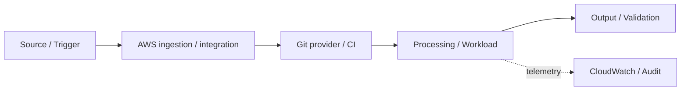

# UC09 — Xây dựng CI/CD tự động

> **UC09 · DEVOPS · PLANNED**

## 1. Business scenario
Thiết kế pipeline test, build artifact/container, scan, deploy theo môi trường và rollback.

## 2. Learning objectives
- Giải thích bài toán, dữ liệu đầu vào/đầu ra và yêu cầu vận hành.
- Đọc và thiết kế được kiến trúc AWS, data flow và trust boundaries.
- Chọn dịch vụ theo workload, security, availability, operations và cost.
- Triển khai bằng Console, CLI/SDK và IaC khi phù hợp.
- Kiểm thử, xử lý lỗi, quan sát hệ thống và dọn dẹp tài nguyên.

## 3. Reference architecture

**Logical flow:** Commit → test → build → security checks → approval → deploy → smoke test.

> Sơ đồ này là bản khái niệm. Bản hoàn thiện cần thể hiện VPC/subnet, endpoints, encryption, IAM trust, network path, error handling và service-specific boundaries theo lab thực tế.

## 4. AWS service selection
- **GitHub Actions** — đánh giá vai trò và cấu hình phù hợp trong lab.
- **GitLab CI** — đánh giá vai trò và cấu hình phù hợp trong lab.
- **CodePipeline** — đánh giá vai trò và cấu hình phù hợp trong lab.
- **CodeBuild** — đánh giá vai trò và cấu hình phù hợp trong lab.
- **ECR** — đánh giá vai trò và cấu hình phù hợp trong lab.
- **ECS** — đánh giá vai trò và cấu hình phù hợp trong lab.
- **Terraform** — đánh giá vai trò và cấu hình phù hợp trong lab.

### 10 WH questions — áp dụng cho từng service
| WH | Câu hỏi bắt buộc |
|---|---|
| What | Dịch vụ là gì, giải quyết capability nào? |
| Why | Vì sao chọn dịch vụ cho scenario này? |
| When | Trường hợp nào nên/không nên dùng? |
| Where | Region, AZ, network placement và availability ra sao? |
| Who | Ai vận hành, IAM principal nào cần quyền? |
| Which | Nên chọn mode, tier hoặc configuration nào? |
| How | Triển khai bằng Console, CLI, SDK và IaC thế nào? |
| How much | Pricing dimensions và cost drivers là gì? |
| What if | Failure modes, limits, recovery và troubleshooting? |
| How compared | So với alternative nào, trade-off ra sao? |

**Status:** chưa hoàn thành cho đến khi có câu trả lời theo từng dịch vụ và dẫn nguồn AWS chính thức.

## 5. Alternatives and decision matrix
| Choice | When to consider | Trade-offs to validate |
|---|---|---|
| AWS managed service | Giảm vận hành hạ tầng | Feature fit, quotas, limits, pricing |
| Self-managed on EC2/container | Cần OS/runtime/customization | Patching, HA, scaling, backup, operations |
| Alternative AWS service | Workload khác về latency/scale/governance | Fit, migration effort, integration, cost |

## 6. Prerequisites
- AWS learning account riêng, MFA và budget/billing alert.
- AWS CLI v2 và identity dùng temporary credentials.
- Git và Python/Docker/Terraform nếu lab cần.
- Synthetic dataset; không dùng dữ liệu khách hàng hoặc thông tin nội bộ.
- Xác nhận Region, quota, service availability và IAM permissions.

## 7. Hands-on labs
| Lab | Nội dung | Status |
|---|---|---|
| Lab 01 | Prepare account, identity, variables and prerequisites | Planned |
| Lab 02 | Build the minimum architecture | Planned |
| Lab 03 | Implement the main workflow | Planned |
| Lab 04 | Validate output and failure cases | Planned |
| Lab 05 | Observe, secure, estimate cost and clean up | Planned |

Mỗi lab hoàn chỉnh phải có mục tiêu, prerequisites, Console steps và screenshots, CLI/SDK code, Terraform nếu phù hợp, expected output, troubleshooting, rollback, cost và cleanup.

## 8. Code and infrastructure
Mã nguồn thực hành được tổ chức trong `usecases/UC09/`:
- `src/`: runnable Python/SQL/shell source.
- `config/`: safe examples và `.env.example` (không lưu secrets thật).
- `infrastructure/terraform/`: infrastructure có thể tái triển khai.
- `tests/`: unit, integration và data validation tests.
- `diagrams/`: Mermaid/Draw.io source và exported images.

## 9. Security, cost and cleanup
- Least-privilege IAM; không hard-code credentials.
- Encryption và secrets management phù hợp với phân loại dữ liệu.
- Chỉ dùng synthetic data; ghi rõ retention và access.
- Ghi Region, assumptions, pricing dimensions và ngày kiểm tra.
- Có teardown cụ thể và xác minh tài nguyên đã được xóa.
- Không chạy destructive commands ngoài learning environment riêng.

## 10. Troubleshooting and operations
Tạo bảng symptom → likely cause → diagnostic → remediation. Bổ sung CloudWatch logs/metrics, audit trail, retry behavior, alert routing và recovery checks khi phù hợp.

## 11. Knowledge check
- [ ] Trả lời đủ 10 WH cho từng AWS service.
- [ ] So sánh service chính với ít nhất hai alternatives khả thi khi phù hợp.
- [ ] Giải thích architecture, data flow và security boundaries.
- [ ] Reproduce lab từ môi trường sạch.
- [ ] Chẩn đoán ít nhất một failure được chủ động tạo ra.
- [ ] Ước tính chi phí và hoàn thành teardown.

## 12. Official references
- [AWS Architecture Center](https://aws.amazon.com/architecture/)
- [AWS Documentation](https://docs.aws.amazon.com/)
- [AWS Pricing Calculator](https://calculator.aws/)

Bổ sung service-specific official docs, quotas/limits, pricing links và ngày kiểm tra khi triển khai lab.