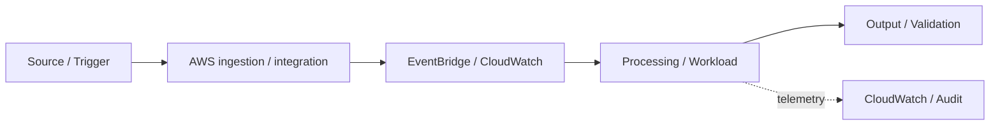

# UC11 — Monitoring, Alert và Incident

> **UC11 · OPERATIONS · PLANNED**

## 1. Business scenario
Giám sát pipeline, endpoint và database; tạo alert, runbook và incident response.

## 2. Learning objectives

Sau khi hoàn thành use case, người học có thể:

- Mô tả business scenario, phạm vi và kết quả cần đạt.
- Giải thích input, output và data flow của giải pháp.
- Đọc và điều chỉnh architecture theo yêu cầu của bài toán.
- Triển khai các bước thực hành bằng AWS Console, CLI/SDK hoặc IaC.
- Thiết lập IAM permissions theo nguyên tắc least privilege.
- Kiểm tra kết quả, thực hiện negative tests và xử lý lỗi phổ biến.
- Ước tính cost drivers, theo dõi vận hành và cleanup tài nguyên.

## 3. Reference architecture

**Logical flow:** Metrics/logs/events → alarms → notification → runbook → recovery.

> Sơ đồ này là bản khái niệm. Bản hoàn thiện cần thể hiện VPC/subnet, endpoints, encryption, IAM trust, network path, error handling và service-specific boundaries theo lab thực tế.

## 4. AWS service selection

Chỉ trình bày các dịch vụ thực sự tham gia vào use case. Với mỗi dịch vụ, nêu rõ vai trò trong kiến trúc, cấu hình được sử dụng, quyền IAM liên quan và lý do lựa chọn. Phần giải thích chuyên sâu theo bộ câu hỏi WH được tập trung tại **AWS Knowledge Base / AWS Fundamentals**, không lặp lại trong từng use case.

| Thành phần | Vai trò trong use case | Nội dung cần làm rõ |
|---|---|---|
| AWS service chính | Cung cấp capability cốt lõi | Cấu hình sử dụng, input/output, giới hạn liên quan |
| Thành phần tích hợp | Kết nối hoặc điều phối luồng xử lý | Data flow, dependency và failure handling |
| Security / governance | Kiểm soát truy cập và bảo vệ dữ liệu | IAM principal, policy scope, encryption và audit |

## 5. Alternatives and decision matrix
| Choice | When to consider | Trade-offs to validate |
|---|---|---|
| AWS managed service | Giảm vận hành hạ tầng | Feature fit, quotas, limits, pricing |
| Self-managed on EC2/container | Cần OS/runtime/customization | Patching, HA, scaling, backup, operations |
| Alternative AWS service | Workload khác về latency/scale/governance | Fit, migration effort, integration, cost |

## 6. Prerequisites
- AWS learning account riêng, MFA và budget/billing alert.
- AWS CLI v2 và identity dùng temporary credentials.
- Git và Python/Docker/Terraform nếu lab cần.
- Synthetic dataset; không dùng dữ liệu khách hàng hoặc thông tin nội bộ.
- Xác nhận Region, quota, service availability và IAM permissions.

## 7. Hands-on labs
| Lab | Nội dung | Status |
|---|---|---|
| Lab 01 | Prepare account, identity, variables and prerequisites | Planned |
| Lab 02 | Build the minimum architecture | Planned |
| Lab 03 | Implement the main workflow | Planned |
| Lab 04 | Validate output and failure cases | Planned |
| Lab 05 | Observe, secure, estimate cost and clean up | Planned |

Mỗi lab hoàn chỉnh phải có mục tiêu, prerequisites, Console steps và screenshots, CLI/SDK code, Terraform nếu phù hợp, expected output, troubleshooting, rollback, cost và cleanup.

## 8. Code and infrastructure
Mã nguồn thực hành được tổ chức trong `usecases/UC11/`:
- `src/`: runnable Python/SQL/shell source.
- `config/`: safe examples và `.env.example` (không lưu secrets thật).
- `infrastructure/terraform/`: infrastructure có thể tái triển khai.
- `tests/`: unit, integration và data validation tests.
- `diagrams/`: Mermaid/Draw.io source và exported images.

## 9. Security, cost and cleanup
- Least-privilege IAM; không hard-code credentials.
- Encryption và secrets management phù hợp với phân loại dữ liệu.
- Chỉ dùng synthetic data; ghi rõ retention và access.
- Ghi Region, assumptions, pricing dimensions và ngày kiểm tra.
- Có teardown cụ thể và xác minh tài nguyên đã được xóa.
- Không chạy destructive commands ngoài learning environment riêng.

## 10. Troubleshooting and operations
Tạo bảng symptom → likely cause → diagnostic → remediation. Bổ sung CloudWatch logs/metrics, audit trail, retry behavior, alert routing và recovery checks khi phù hợp.

## 11. Knowledge check
- [ ] Trình bày được vai trò và cấu hình của từng AWS service trong use case.
- [ ] So sánh service chính với ít nhất hai alternatives khả thi khi phù hợp.
- [ ] Giải thích architecture, data flow và security boundaries.
- [ ] Reproduce lab từ môi trường sạch.
- [ ] Chẩn đoán ít nhất một failure được chủ động tạo ra.
- [ ] Ước tính chi phí và hoàn thành teardown.

## 12. Official references
- [AWS Architecture Center](https://aws.amazon.com/architecture/)
- [AWS Documentation](https://docs.aws.amazon.com/)
- [AWS Pricing Calculator](https://calculator.aws/)

Bổ sung service-specific official docs, quotas/limits, pricing links và ngày kiểm tra khi triển khai lab.